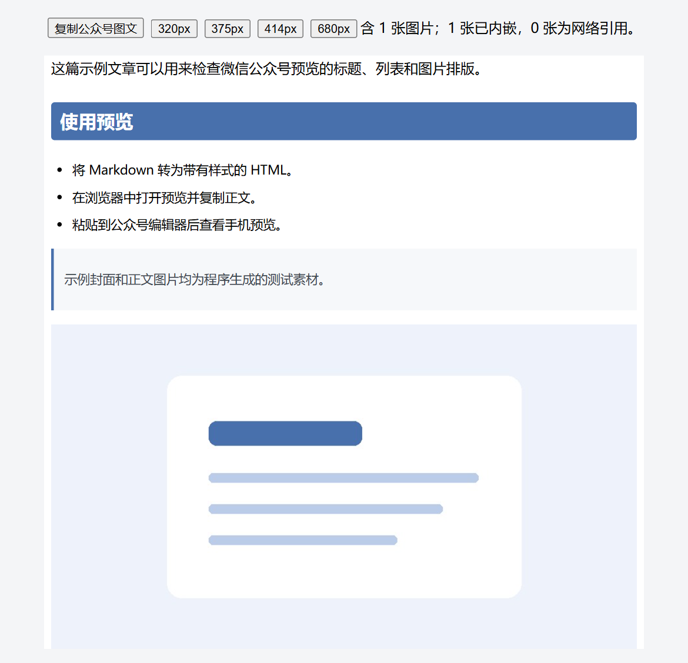
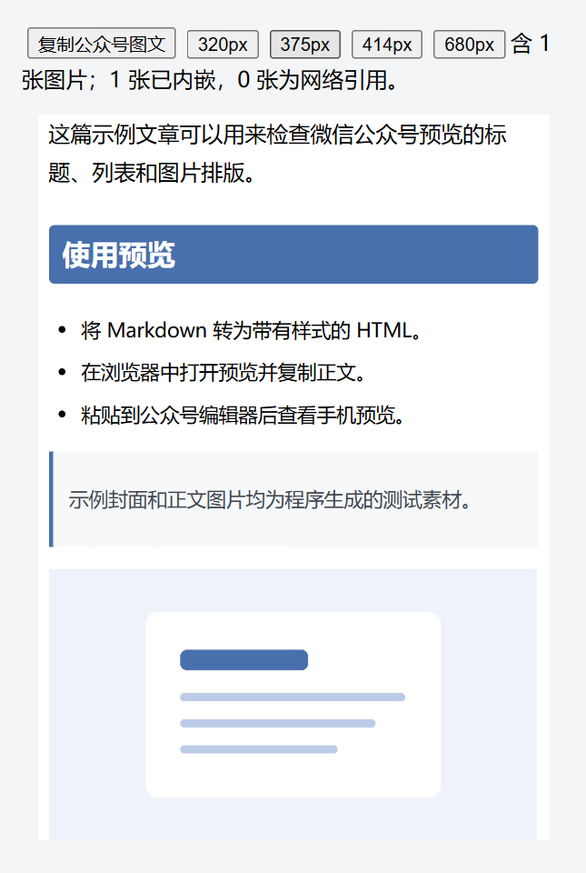

# wechat-publisher

**这是一个给 Codex 使用的微信公众号排版 Skill。** 它把 Markdown 转成可复制的微信公众号图文，也可以把文章上传到公众号草稿箱。仓库里有 `SKILL.md`、排版主题和可独立运行的脚本。

| 名称 | 在哪里使用 | 用来做什么 |
| --- | --- | --- |
| **wechat-publisher Skill（本仓库）** | 在 Codex 聊天中调用，也可在终端运行脚本 | 生成浏览器预览、复制公众号图文、上传草稿 |
| **Enhanced Publisher 插件** | 在 Obsidian 内安装和使用 | 在 Obsidian 中打开 HTML 预览。预览顶部留白的修复属于这个插件 |

Markdown 可以来自 Obsidian，也可以来自其他编辑器。用本仓库处理 Obsidian 笔记时，只需把 Markdown 文件路径交给 Codex 或脚本。

## 能做什么

- **预览排版。** 将 Markdown 渲染为 LAPIS 风格的本地 HTML，可切换 320、375、414 和 680 像素宽度查看。
- **复制图文。** 预览会嵌入正文引用的本地图片。点击「复制公众号图文」后，可粘贴到公众号编辑器检查排版。预览和复制无需公众号凭证。
- **上传草稿。** 配置自己的公众号凭证后，可将带标题和封面的文章写入草稿箱。正式发表在公众号后台操作。

## 预览截图

两张图都由仓库中的 [示例 Markdown](example.md) 实际生成。

**桌面浏览器预览。** 顶部可以复制图文和切换宽度，下方显示排版后的标题、列表、引用与图片。



**375 像素窄屏预览。** 可在粘贴前检查正文换行和图片大小。



## 怎么用

需要 Node.js 和 Wenyan CLI。已验证的版本为 Node.js 24 和 `@wenyan-md/cli` 2.0.11。

```bash
npm install -g @wenyan-md/cli@2.0.11
```

### 在 Codex 中使用

从仓库的 **Releases** 下载 `wechat-publisher.zip`，解压后把完整的 `wechat-publisher` 目录放到 Codex 的技能目录。Windows 用户也可以在解压后的目录运行 `.\scripts\install.ps1` 安装。然后在 Codex 聊天中提供 Markdown 文件，例如这样说。

> 用 wechat-publisher 把这篇 Markdown 生成可复制的微信公众号预览。

### 在终端运行

进入解压后的 `wechat-publisher` 目录，运行以下命令。

```bash
node scripts/render-safe.mjs example.md article-preview.html
node scripts/publish.mjs example.md --dry-run
```

第一条命令生成本地预览，第二条检查草稿参数。打开 `article-preview.html` 即可预览并复制。

要创建草稿，请先在私有环境中设置 `WECHAT_APP_ID` 和 `WECHAT_APP_SECRET`，再用自己的文章替换 `example.md`。文章须有 `title` 和 `cover`，准备好后移除 `--dry-run` 执行。

更多用法见 [SKILL.md](SKILL.md)，第三方主题许可见 [licenses](licenses/)。
